# Домашнее задание к занятию «Уязвимости и атаки на информационные системы» Dunaevskaya Olga

 # Задание 1
 # 1.1. В результате сканирования виртуальной машины Metasploitable 2 с помощью Nmap обнаружено 27 открытых TCP-портов, на которых доступны сетевые службы.
Среди них: FTP, SSH, Telnet, SMTP, DNS, HTTP, RPC, SMB, rexec, rlogin, rsh, Java RMI, NFS, MySQL, PostgreSQL, VNC, X11, IRC, distccd, AJP13, Apache Tomcat и Ruby DRb RMI.
Наиболее значимые службы:
•	FTP — передача файлов;
•	SSH и Telnet — удалённое подключение;
•	HTTP и Tomcat — предоставление веб-сервисов;
•	SMB и NFS — сетевой доступ к файлам;
•	MySQL и PostgreSQL — управление базами данных;
•	VNC и X11 — удалённый графический доступ.
  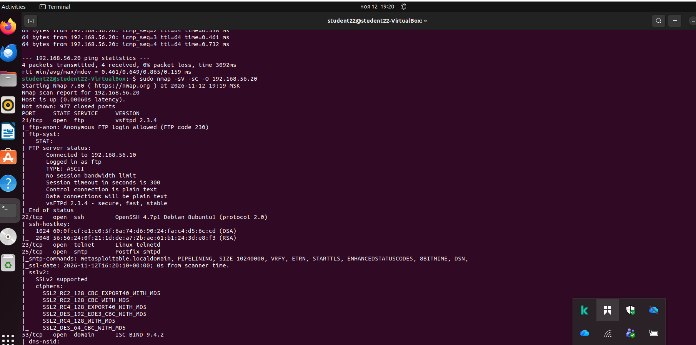
  Результаты полного сканирования:

# 1.2.Уязвимости
1. vsftpd 2.3.4 — Backdoor Command Execution
Критическая опасность
•	Порт: 21
•	CVE-2011-2523
•	EDB-ID: 17491
•	Описание: внедрённый бэкдор в дистрибутиве позволял удалённо выполнять команды.
Exploit-DB: EDB-17491
Unix remote Exploit
2. UnrealIRCd — Backdoor Command Execution
Критическая опасность
•	Порт: 6667
•	CVE-2010-2075
•	EDB-ID: 13853
•	Описание: в заражённом дистрибутиве UnrealIRCd 3.2.8.1 присутствовал бэкдор для удалённого выполнения команд.
Exploit-DB: EDB-13853
Linux remote Exploit
Версию UnrealIRCd 3.2.8.1 ещё нужно подтвердить отдельно: Nmap пока показал только название службы.
3. distcc — Daemon Command Execution
Высокая опасность
•	Порт: 3632
•	CVE-2004-2687
•	EDB-ID: 9915
•	Описание: ошибка конфигурации distccd позволяет удалённо выполнять команды без аутентификации.
Exploit-DB: EDB-9915
Multiple remote Exploit+1

 # Задание 2
 # 2.1. SYN-сканирование
Команда:
sudo nmap -sS -p 1-1000 192.0.0.20
Результат: обнаружено 12 открытых TCP-портов:
21, 22, 23, 25, 53, 80, 111, 139, 445, 512, 513, 514.
Анализ в Wireshark:
Был обнаружен SYN-пакет от сканирующей машины и ответ SYN-ACK от целевой машины на порт 80.
Это свидетельствует о том, что порт открыт и готов принимать TCP-соединения.
При SYN-сканировании Nmap не завершает стандартное TCP-соединение, а после получения SYN-ACK отправляет RST.

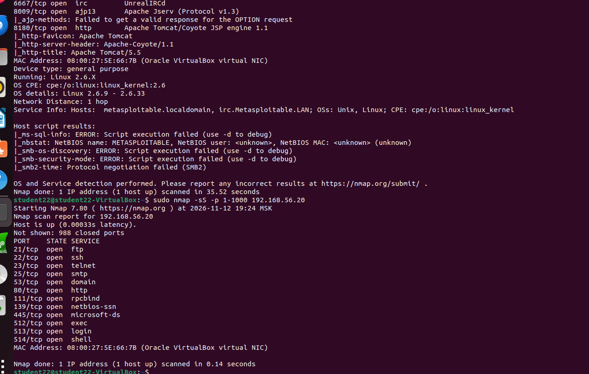

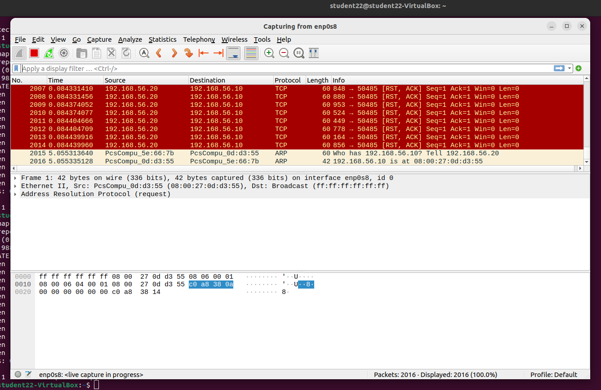

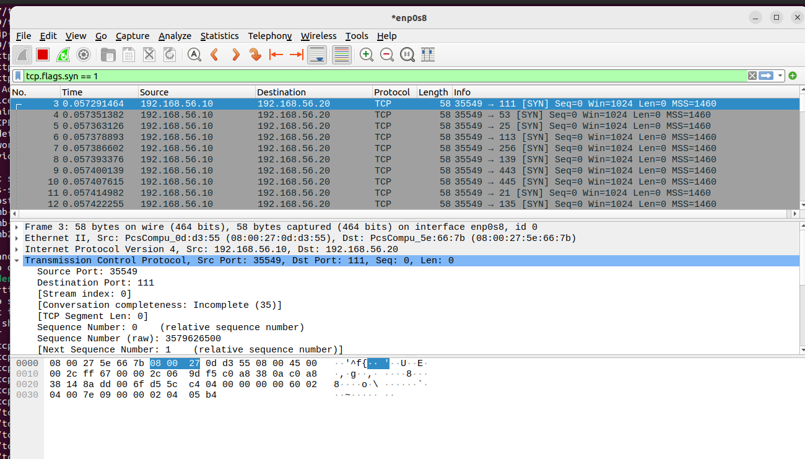
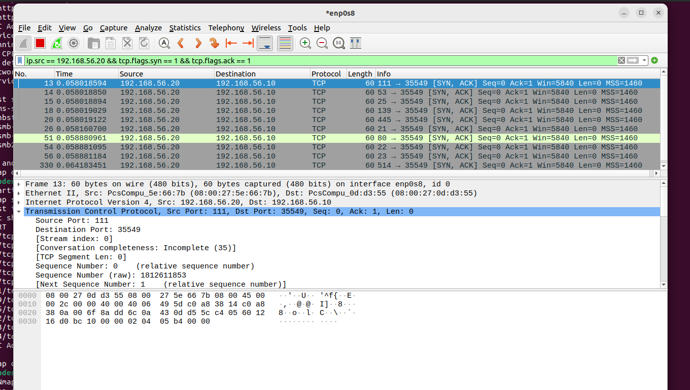

# 2.2. FIN-сканирование
Команда:
sudo nmap -sF -p 1-1000 192.0.0.20
Результат: все 12 проверяемых открытых TCP-портов получили состояние open|filtered.
Анализ в Wireshark:
Был обнаружен TCP-пакет с установленным флагом FIN.
Особенность метода: закрытые порты обычно отвечают RST, а открытые порты в Linux обычно игнорируют FIN-пакеты. Поэтому отсутствие ответа не позволяет однозначно определить состояние порта.

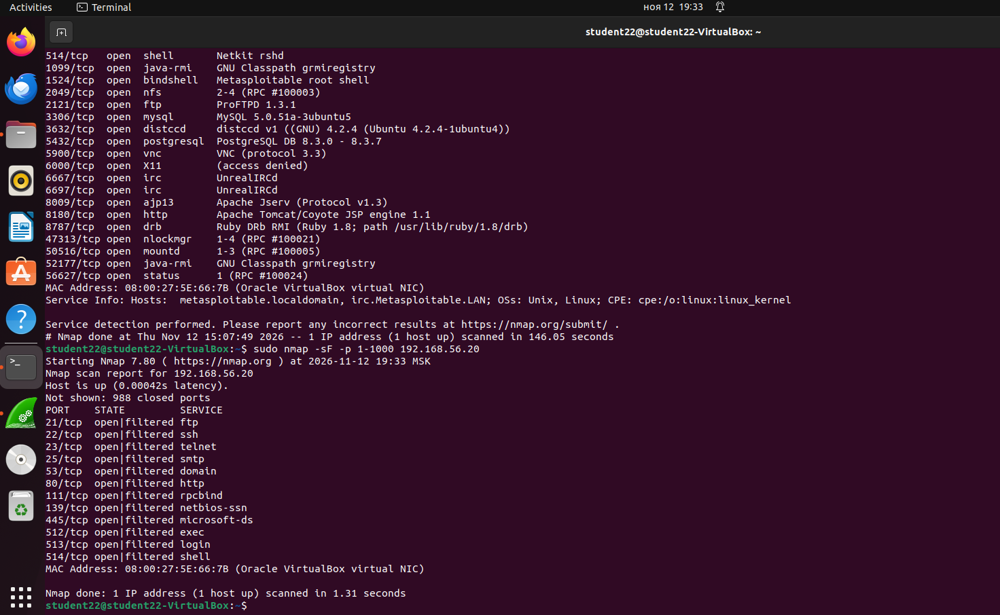

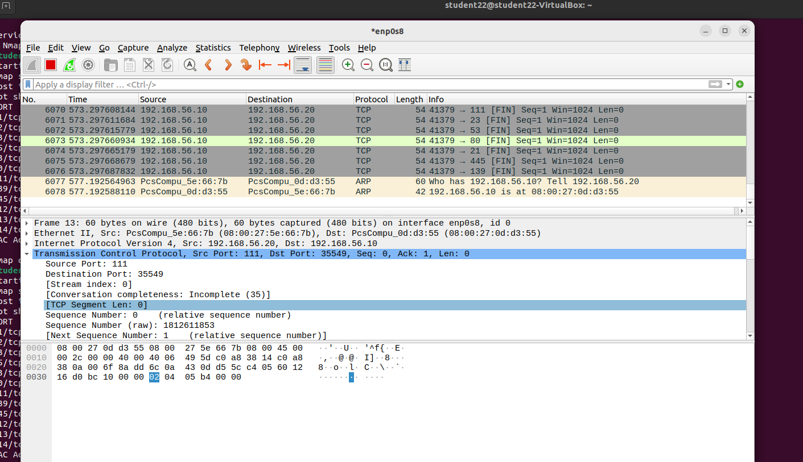

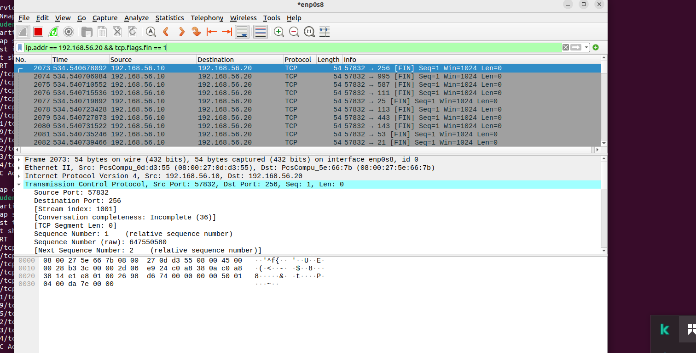

# 2.3. Xmas-сканирование
Команда:
sudo nmap -sX -p 1-1000 192.0.0.20
Результат: все 12 проверяемых TCP-портов получили состояние open|filtered.
Анализ в Wireshark:
Был обнаружен TCP-пакет со следующими установленными флагами:
•	FIN — Set;
•	PSH (Push) — Set;
•	URG — Set.
Эта комбинация флагов характерна для Xmas-сканирования.
Закрытые порты обычно отвечают RST, а открытые порты Linux, как правило, не отвечают на такие запросы.

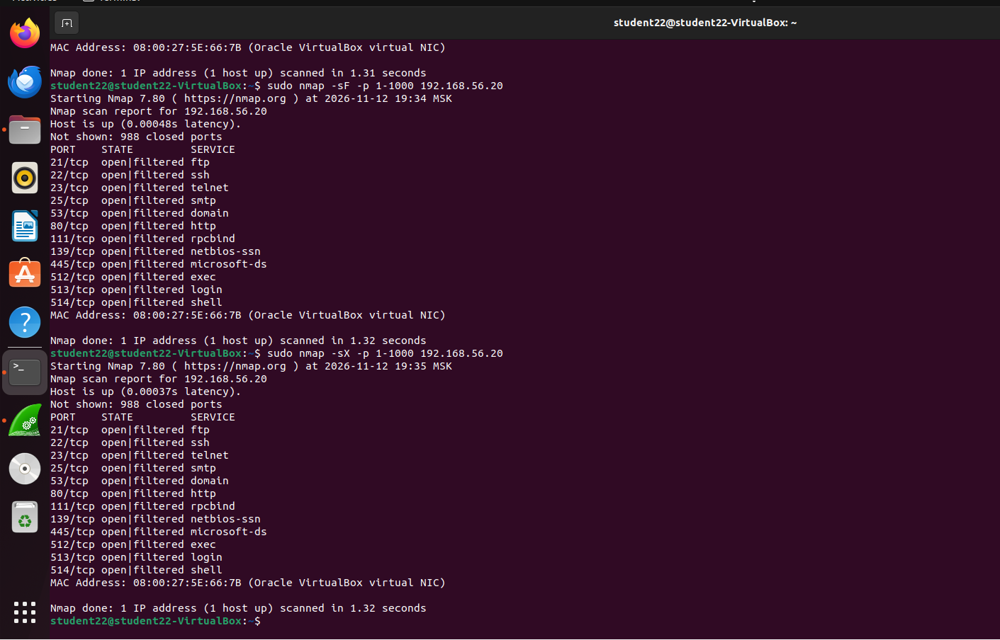

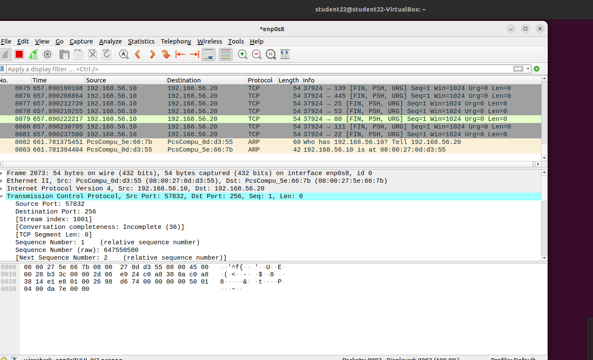

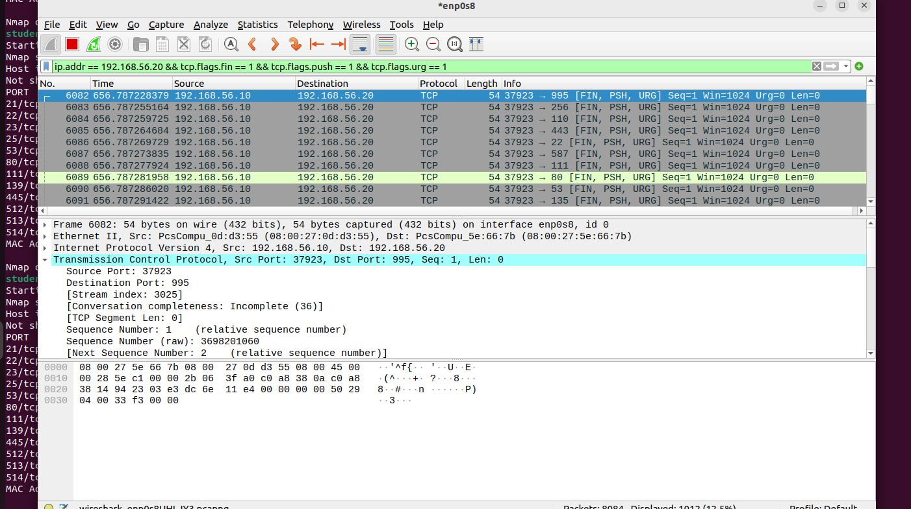

# 2.4. UDP-сканирование
Команда:
sudo nmap -sU --top-ports 100 192.0.0.20
Результат: обнаружены следующие UDP-порты:
Порт	Служба	Состояние
53	DNS	open
68	DHCP client	open|filtered
69	TFTP	open|filtered
111	RPCBind	open
137	NetBIOS Name Service	open
138	NetBIOS Datagram	open|filtered
2049	NFS	open
Остальные 93 проверенных UDP-порта определены как закрытые.
UDP не устанавливает соединение, поэтому открытые службы могут отвечать непосредственно UDP-пакетами. Закрытые порты обычно возвращают ICMP Destination Unreachable, Code 3 (Port Unreachable). Отсутствие ответа может означать состояние open|filtered.

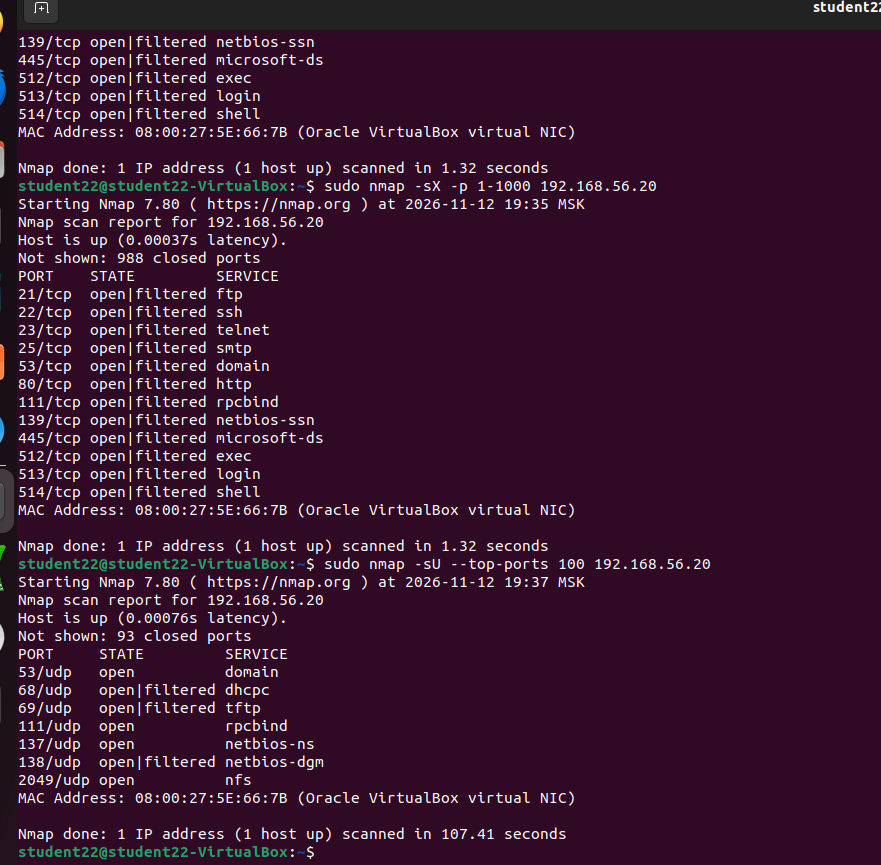

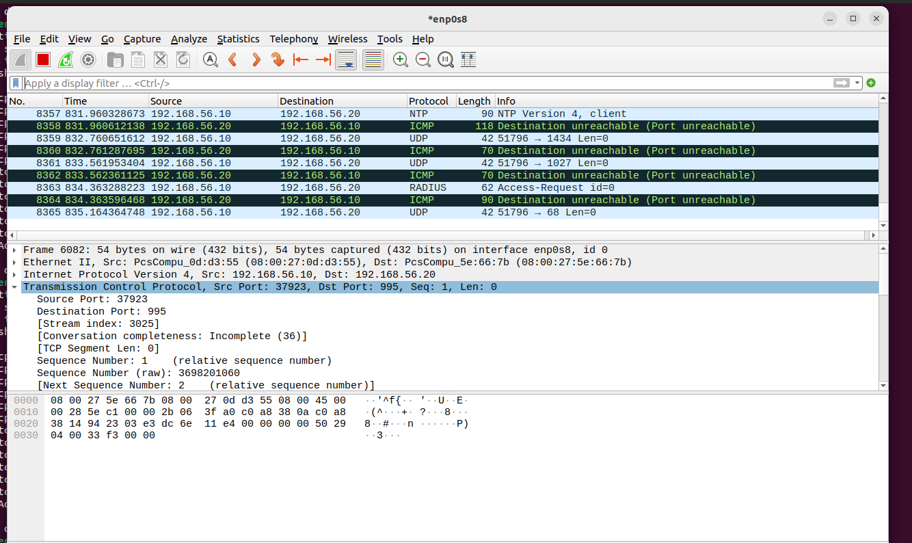

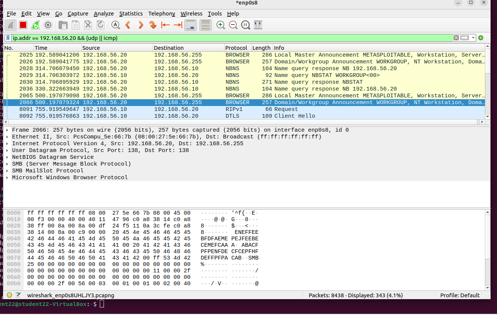

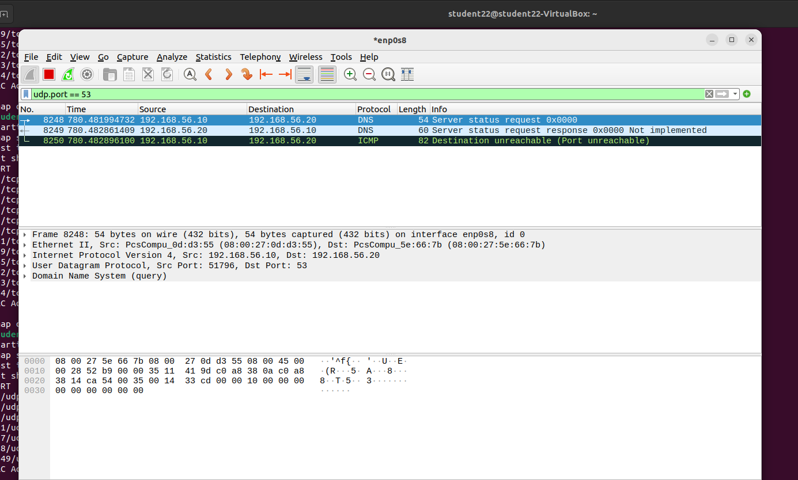

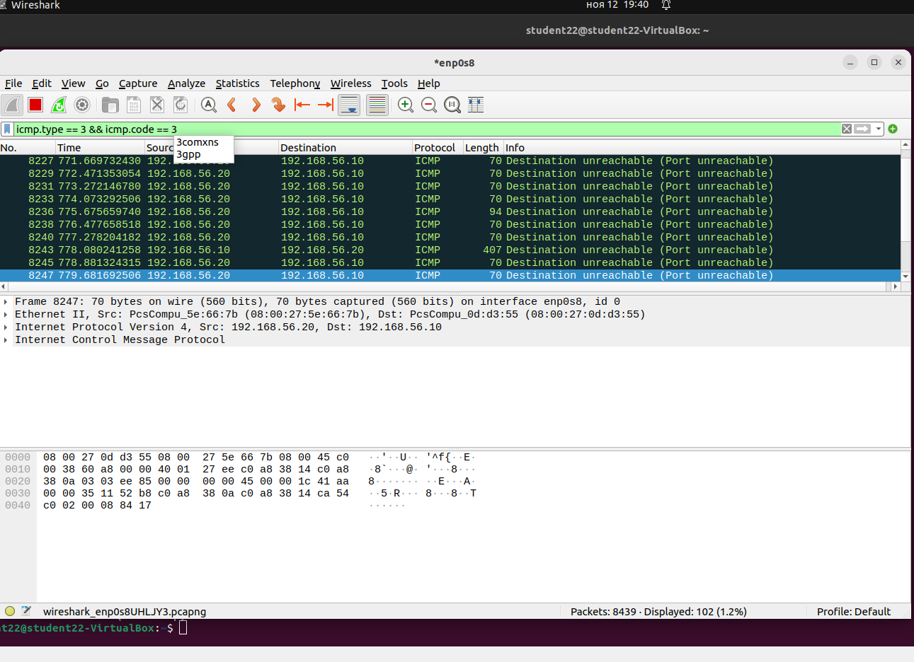

Запись:

